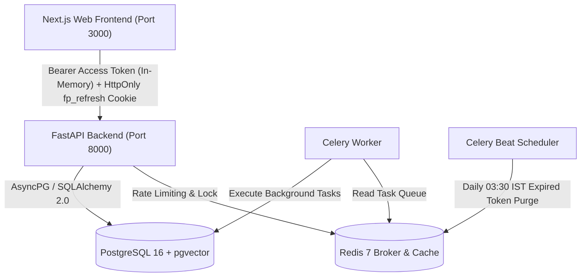
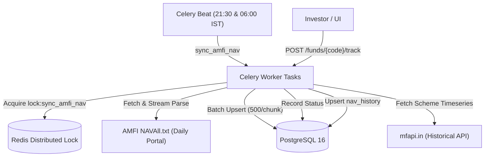

# FolioPilot

FolioPilot is a full-stack personal finance platform engineered specifically for Indian mutual fund investors.

This repository holds the Phase 0 foundational architecture upon which all future investment analysis, synchronization, portfolio tracking, and AI capabilities are built.

---

## Prerequisites
- **Docker & Docker Compose** (Docker Desktop with Compose v2)
- **Python 3.12+** and **uv** (for local backend development)
- **Node.js 20+** and **npm** (for local frontend development)
- **Make** (optional, for convenience commands)

> **Windows Note on `@next/swc-wasm-nodejs`**:
> `@next/swc-wasm-nodejs` is pinned in `apps/web/package.json` under `optionalDependencies`. On Windows hosts, native SWC binaries (`@next/swc-win32-x64-msvc`) may fail to load in certain container mounts or Windows build environments; having the exact matching WASM fallback ensures Next.js compilation reliably falls back without breaking builds or container execution.

---

## Quickstart

### 1. Clone & Configure Environment
```bash
cp .env.example .env
```
*(Review and customize any placeholder values in `.env` as needed)*

### 2. Start Services via Docker Compose
```bash
make up
# or: docker compose up -d
```

### 3. Run Database Migrations
```bash
make migrate
# or: docker compose exec api alembic upgrade head
```

### 4. Access Services & Endpoints
- **Frontend Web Application**: [http://localhost:3000](http://localhost:3000)
  - `/login`: Investor sign in with client and server validation
  - `/register`: New investor account registration with Argon2id hashing
  - `/dashboard`: Protected investor dashboard (AuthGate)
  - `/funds`: Mutual fund directory with debounced search, filters, and freshness status
  - `/funds/[schemeCode]`: Fund detail view with interactive NAV history chart and track toggle
- **Backend API Endpoints**:
  - `POST /api/v1/auth/register`: Create user account & initial refresh token family (201)
  - `POST /api/v1/auth/login`: Authenticate credentials with timing protection (200)
  - `POST /api/v1/auth/refresh`: Rotate token family with pessimistic row lock (200)
  - `POST /api/v1/auth/logout`: Revoke active token family & clear cookie (200)
  - `POST /api/v1/auth/logout-all`: Revoke all sessions across all devices for user (200)
  - `GET /api/v1/users/me`: Return authenticated user profile (200)
  - `GET /api/v1/funds/search`: Search mutual funds with trigram similarity, filters & 60 req/min rate limit (200)
  - `GET /api/v1/funds/{scheme_code}`: Return fund master details and latest NAV (200)
  - `GET /api/v1/funds/{scheme_code}/nav`: Return historical daily NAV timeseries for tracked fund (200)
  - `POST /api/v1/funds/{scheme_code}/track`: Mark fund as tracked and enqueue background backfill (202)
  - `GET /api/v1/nav/status`: Status of latest AMFI NAV ingestion and freshness indicator (200)
  - `GET /api/v1/health`: Lightweight liveness probe (200)
  - `GET /api/v1/health/ready`: PostgreSQL & Redis readiness probe (200/503)
  - `GET /docs`: Swagger OpenAPI documentation (development mode)

---

## Architecture & Authentication Design



### Authentication & Token Rotation Guarantees
- **Memory-Only Access Tokens**: 15-minute JWTs are stored strictly in memory (`apps/web/src/lib/auth-token.ts`), never in `localStorage` or `sessionStorage`, mitigating XSS credential theft.
- **HttpOnly Refresh Cookies**: 7-day opaque tokens delivered strictly via `fp_refresh` cookie (`Path=/api/v1/auth`, `SameSite=Lax`, `HttpOnly=True`).
- **Token Family Rotation**: Every refresh rotates the token under a PostgreSQL pessimistic lock (`with_for_update()`).
- **Grace Window Tradeoff**: When multiple tabs trigger token refresh simultaneously, requests arriving within `REFRESH_GRACE_SECONDS` (10s) receive a new access token without rotating the cookie, avoiding multi-tab logout races. Any token reuse outside the grace window triggers immediate revocation of the entire family (`REFRESH_TOKEN_REUSED`).
- **CSRF & CORS Safety**: All cookie-authenticated endpoints verify the `Origin` header against explicit `CORS_ORIGINS`. Startup fails fast if `*` is present with credentials enabled.
- **Sensitive Log Redaction**: Structlog processor automatically redacts passwords, tokens, cookies, and secrets.

---

## Testing & Quality Gates

### Test Isolation Safety Gate
All integration tests run against isolated databases:
- **PostgreSQL**: Must connect to a test database ending in `_test` (`foliopilot_test`). The test runner automatically provisions `foliopilot_test` and refuses execution if pointing to any database not ending in `_test`.
- **Redis**: Must connect to database index `1` (`redis://.../1`). Only database index 1 is ever flushed during tests.

### Running Test Suites
```bash
# Backend unit tests (runs without Docker)
apps/api/.venv/Scripts/python -m pytest apps/api/tests/unit

# Backend integration tests (requires Docker PostgreSQL & Redis)
apps/api/.venv/Scripts/python -m pytest apps/api/tests/integration

# Frontend tests (Vitest)
npm --prefix apps/web test

# Static type and style checks
apps/api/.venv/Scripts/ruff check apps/api
apps/api/.venv/Scripts/ruff format --check apps/api
apps/api/.venv/Scripts/mypy --config-file apps/api/pyproject.toml apps/api/app apps/api/tests/unit
npm --prefix apps/web run lint
npm --prefix apps/web run typecheck
npm --prefix apps/web run build
```

---

## Makefile Targets

| Target | Description |
|---|---|
| `make up` | Start all Docker services (DB, Redis, API, Worker, Beat, Web) |
| `make down` | Stop and tear down all Docker containers |
| `make logs` | Tail logs across all running containers |
| `make migrate` | Run pending Alembic migrations on the PostgreSQL database |
| `make makemigration m="name"` | Autogenerate a new Alembic migration |
| `make test` | Run test suites across both API (pytest) and Web (vitest) |
| `make test-api` | Run backend tests using pytest |
| `make test-web` | Run frontend tests using vitest |
| `make lint` | Run Ruff linter on backend and ESLint on frontend |
| `make format` | Format backend with Ruff and frontend with Prettier |
| `make typecheck` | Run mypy strict on backend and TypeScript compiler on web |
| `make shell-api` | Open a bash shell in the running API container |
| `make psql` | Open a PostgreSQL shell connected to the database |
| `make sync-nav` | Trigger one-off AMFI NAV sync from terminal |
| `make backfill-nav CODE=<scheme_code>` | Trigger historical NAV backfill for a scheme from mfapi.in |
| `make rebuild-web` | Rebuild web container and renew anonymous node_modules volume |
| `make rebuild-python` | Rebuild api, worker & beat containers and renew .venv volume |
| `make smoke` | Run health and route smoke checks across web and api services (PowerShell-only script `scripts/smoke.ps1` for local dev; not run in Linux CI) |

### Dependencies Changed?
If dependencies changed in `package.json` or `uv.lock`, run:
- **Frontend**: `make rebuild-web` (or `docker compose up -d --build --no-deps -V web`)
- **Backend**: `make rebuild-python` (or `docker compose up -d --build --no-deps -V api worker beat`)

Both container environments also include entrypoint lock-hash guards that detect package changes and sync dependencies automatically on startup.

---

## Project Structure

```
.
├── apps/
│   ├── api/                  # FastAPI backend service
│   │   ├── app/
│   │   │   ├── main.py       # Application factory, middleware & routing
│   │   │   ├── core/         # Config, logging, error handling, DB & Redis
│   │   │   ├── api/          # HTTP routers (v1 prefix)
│   │   │   ├── models/       # SQLAlchemy 2.0 models & Base
│   │   │   ├── schemas/      # Pydantic schemas & response envelopes
│   │   │   ├── services/     # Pure business logic
│   │   │   ├── workers/      # Celery worker application & tasks
│   │   │   └── ai/           # AI & RAG tooling (reserved for later phases)
│   │   ├── alembic/          # Database migrations & env.py
│   │   ├── tests/            # Unit & integration test suites
│   │   ├── pyproject.toml    # Dependency & tool configurations
│   │   └── Dockerfile        # Multi-stage production container
│   └── web/                  # Next.js App Router frontend
│       ├── src/
│       │   ├── app/          # App Router layouts & pages
│       │   ├── components/   # UI components (shadcn/ui style) & providers
│       │   └── lib/          # Typed API client, TanStack Query, utils
│       └── Dockerfile        # Web container
├── docker-compose.yml        # Local multi-service infrastructure
├── Makefile                  # Developer workflow commands
├── .pre-commit-config.yaml   # Pre-commit hooks
├── .github/workflows/ci.yml  # GitHub Actions CI pipeline
├── .env.example              # Environment template
├── CONVENTIONS.md            # Architecture & engineering contract
└── README.md
```

---

## Mutual Fund Master & NAV Ingestion (Phase 2)



### Ingestion & Data Architecture
- **Master Data**: Fetched daily from AMFI portal (`NAVAll.txt`). Parses ~15,000 active Indian mutual fund schemes across all AMCs.
- **Classification Engine**: Deterministic classification into `asset_class` (`equity`, `debt`, `hybrid`, `commodity`, `solution_oriented`, `other`) and `sub_category`, with rule-based heuristics for Index Funds, ETFs, and Gold.
- **Distributed Concurrency Guard**: Redis-backed distributed lock with Lua script owner verification prevents overlapping ingestion jobs.
- **Sanity Protection**: Aborts ingestion without mutating the database if parsed records < 5,000 or < 70% of previously active schemes, protecting against truncated feeds or upstream HTML errors.
- **Historical Backfill**: Historical daily NAV data is fetched on-demand from `mfapi.in` strictly for tracked schemes (`funds.is_tracked = True`) with a 1-second polite rate limit.
- **Periodic Schedules**:
  - `sync-amfi-nav-evening`: Runs daily at 21:30 IST (`16:00 UTC`), after AMC cutoffs.
  - `sync-amfi-nav-morning`: Runs daily at 06:00 IST (`00:30 UTC`), catching late-reporting funds.

---

## Roadmap

- **Phase 0**: Architecture foundation & conventions (Completed)
- **Phase 1**: Authentication (JWT with refresh rotation, reuse detection, rate limiting) (Completed)
- **Phase 2**: AMFI Mutual Fund Master & NAV synchronization (Completed)
- **Phase 3**: Portfolios, SIPs & transaction ledger (Next)
- **Phase 4**: Statement imports (Excel & Consolidated Account Statement / CAS PDF)
- **Phase 5**: Valuation engine (XIRR) & capital gains tax calculation
- **Phase 6**: Rebalancing, risk profiling & Monte Carlo goal simulation
- **Phase 7**: Investor alerts & notifications
- **Phase 8**: AI investment assistant & factsheet RAG (pgvector)
- **Phase 9**: Evaluation harness & system verification

